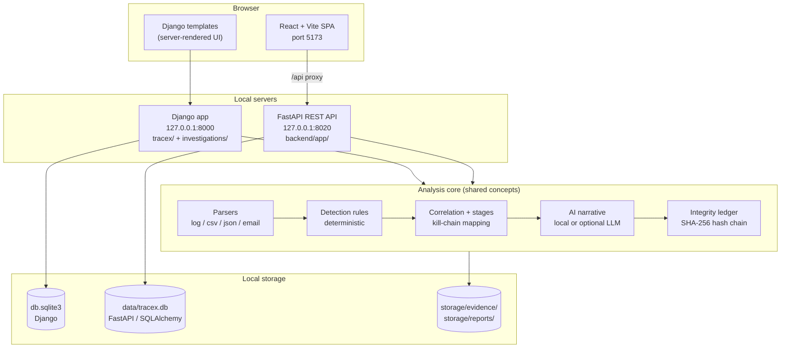
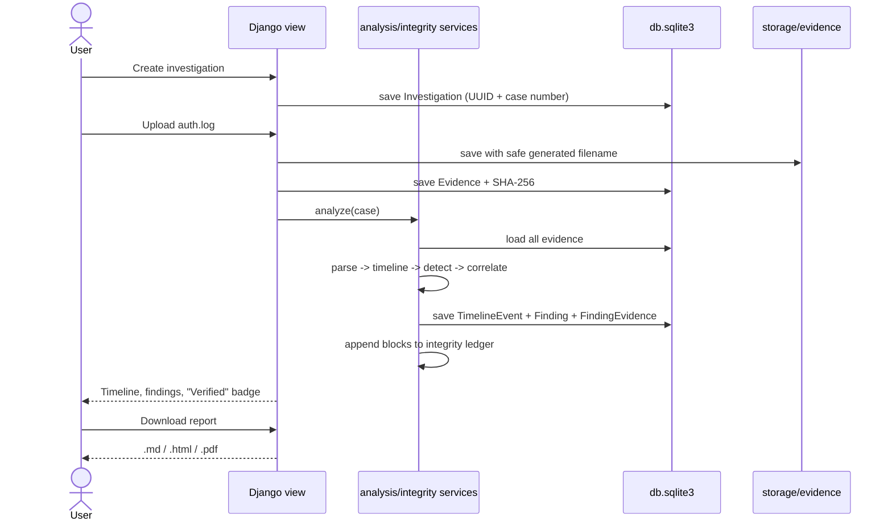
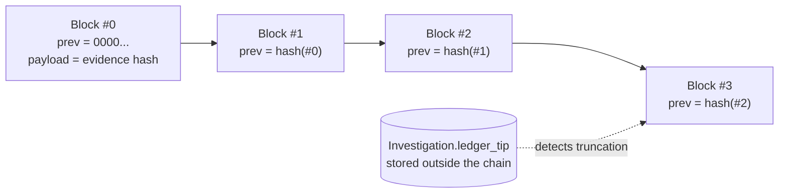
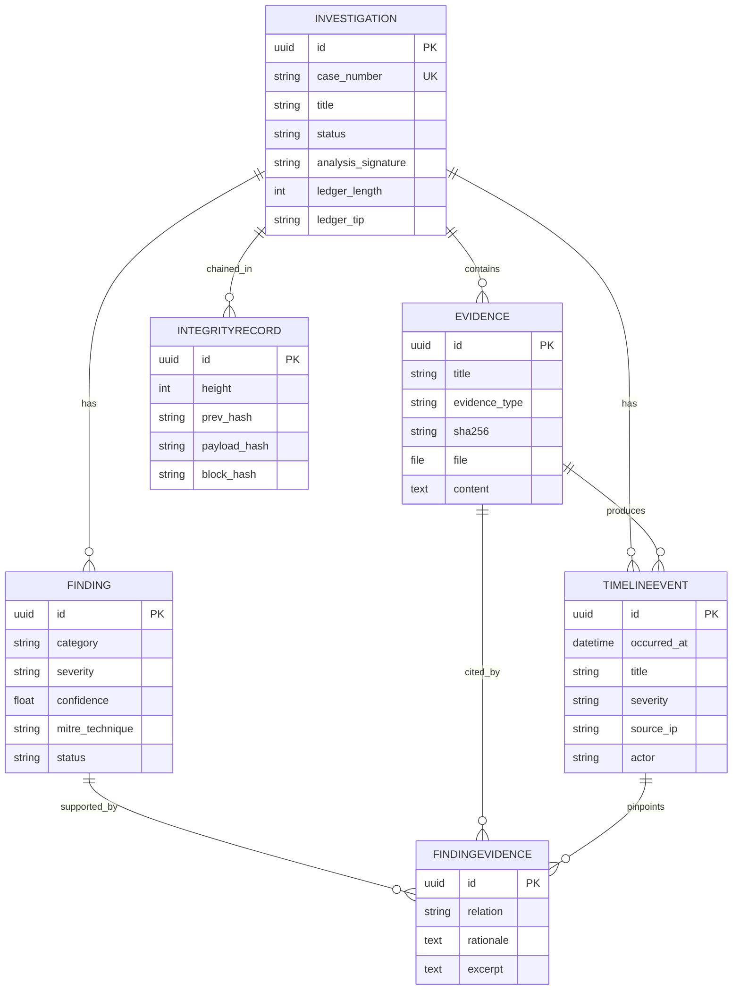

# TRACE-X — AI-Powered Cyber Investigation Assistant

TRACE-X turns messy digital evidence — auth logs, e-mails, firewall logs, IDS alerts,
netflow CSVs — into a **clear, time-ordered story of what happened during a cyber
incident**, with every conclusion linked back to the exact line of evidence that
supports it.

> In plain English: imagine a detective who receives hundreds of scattered clues.
> TRACE-X reads all the clues, puts them on a single timeline, spots suspicious
> patterns (like 10 failed passwords followed by a success), and writes a report
> that says *"here is what I think happened, and here is the proof."*

The project runs **fully locally by default**. Evidence is never uploaded to a
third party unless you explicitly enable an external AI provider.

---

## Table of contents

1. [Why TRACE-X?](#why-trace-x)
2. [Key features](#key-features)
3. [Architecture at a glance](#architecture-at-a-glance)
4. [How the analysis works (step by step)](#how-the-analysis-works-step-by-step)
5. [The tamper-evident integrity ledger](#the-tamper-evident-integrity-ledger)
6. [Repository structure](#repository-structure)
7. [Two ways to run it](#two-ways-to-run-it)
8. [Configuration reference](#configuration-reference)
9. [API reference](#api-reference)
10. [Demo data & credentials](#demo-data--credentials)
11. [Tests & verification](#tests--verification)
12. [Detection rules & MITRE mapping](#detection-rules--mitre-mapping)
13. [Security notes](#security-notes)
14. [Tech stack](#tech-stack)

---

## Why TRACE-X?

| Problem a human investigator faces | How TRACE-X helps |
|---|---|
| Evidence comes in many formats (logs, CSV, `.eml`, JSON) | Parsers normalize everything into one event shape |
| Timestamps differ across systems | Timestamps are parsed and sorted into one chronology |
| Hard to see links between sources | Correlation joins events by IP, user, host, and time window |
| AI can "make up" conclusions | A deterministic rule engine runs first; findings must cite real event/evidence IDs |
| How do you prove evidence was not altered? | SHA-256 fingerprints + an append-only hash chain detect tampering |
| Reports take hours to write | Markdown / HTML / PDF reports are generated automatically |

---

## Key features

- **Evidence fingerprinting** — every upload is hashed with SHA-256 on arrival.
- **Multi-format parsers** — auth/syslog, proxy/firewall logs, JSON alerts, CSV/netflow, raw e-mail (`.eml`, `.txt`).
- **Normalized timeline** — all events sorted by time with severity, source/destination IP, actor, and raw excerpt.
- **Deterministic detection engine** — brute force, account compromise, privilege escalation, sensitive-file access, bulk access, large/aggregate transfers, impossible travel, suspicious IPs, after-hours logins.
- **Cross-source correlation** — links events sharing user, IP, hostname, or close timestamps into attack chains.
- **Attack-stage mapping** — maps events to a Cyber Kill Chain stage (Initial Access → Exfiltration → Impact).
- **Evidence-to-conclusion traceability** — `Finding → Event → Evidence → raw excerpt` is stored and displayed.
- **Tamper-evident ledger** — `block_hash = SHA-256(height | timestamp | prev_hash | payload_hash)`, plus an out-of-band tip anchor to detect chain truncation.
- **Reports** — generated in Markdown, HTML, and PDF.
- **Global search, audit log, dashboard statistics** — across all investigations.
- **Two front ends** — a server-rendered Django UI and a React + Vite single-page app.
- **Privacy switch** — local deterministic AI by default; optional OpenAI-compatible provider via environment variables only.

---

## Architecture at a glance

TRACE-X contains **two runnable applications** that share the same ideas and the same
`demo/evidence` samples:

1. **Django application** (`tracex/`, `investigations/`, `templates/`, `static/`) —
   the main, login-protected web UI. Uses its own SQLite database (`db.sqlite3`).
2. **FastAPI + React stack** (`backend/`, `frontend/`) — a REST API with a modern
   SPA dashboard. Uses its own SQLite database (`data/tracex.db`) and can use PostgreSQL
   through `TRACE_X_DB_URL`.



### Request flow for a single investigation (Django UI)



---

## How the analysis works (step by step)

```mermaid
flowchart LR
    A["1. Raw evidence<br/>logs, CSV, JSON, e-mail"] --> B["2. Parse & normalize<br/>one Event shape"]
    B --> C["3. Timeline<br/>sort by timestamp"]
    C --> D["4. Detect<br/>rules over events"]
    D --> E["5. Correlate<br/>shared IP / user / time"]
    E --> F["6. Classify stages<br/>Cyber Kill Chain"]
    F --> G["7. Explain<br/>deterministic or LLM narrative"]
    G --> H["8. Findings<br/>title, severity, confidence, MITRE"]
    H --> I["9. Traceability links<br/>Finding -> Event -> Evidence"]
    I --> J["10. Ledger + report<br/>hash chain + MD/HTML/PDF"]
```



1. **Ingest** — bytes are hashed with SHA-256 before anything else happens.
2. **Parse** — `backend/app/parsers/` (FastAPI stack) or
   `investigations/services/analysis.py` (Django stack) extracts timestamps, IPs,
   users, actions, and file paths.
3. **Normalize** — each line becomes an `Event` with a stable code and a raw excerpt.
4. **Detect** — threshold-based rules produce candidate findings. Rules run *before*
   any AI, so every candidate already has real event IDs.
5. **Correlate** — events sharing IP/user/host within a time window become chains.
6. **Stage** — events are tagged with a Kill Chain phase; only stages backed by real
   events are reported.
7. **Explain** — the default `DeterministicProvider` writes the summary locally.
   Optionally an OpenAI-compatible model can write it (`AI_PROVIDER=openai`), and its
   output is validated: any finding that cites a non-existent ID is dropped.
8. **Report** — case report generated as Markdown, HTML, and PDF.

---

## The tamper-evident integrity ledger

The ledger is an **append-only hash chain** — like a notebook where every new line
contains the fingerprint of the line before it. If someone edits an old line, every
later fingerprint breaks.



Formula (see `investigations/services/integrity.py` and `backend/app/integrity/ledger.py`):

```
block_hash = SHA-256(height | timestamp | prev_hash | payload_hash)
```

- `payload_hash` covers evidence, timeline events, and findings.
- `prev_hash` links each block to its predecessor.
- `ledger_length` + `ledger_tip` live on the investigation record, outside the chain,
  so deleting the newest blocks (truncating the ledger) is also detected.
- Verification recomputes every hash and compares stored vs. current file hashes.

---

## Repository structure

```text
TRACE-X/
├── manage.py                      # Django command-line entry point
├── requirements.txt               # Django dependency
├── db.sqlite3                     # (runtime) Django database
│
├── tracex/                        # Django project settings & URL root
│   ├── settings.py                # env-driven config, installed apps, DB, media
│   ├── urls.py                    # /admin, /accounts, /api/health, /media (protected)
│   ├── context_processors.py      # exposes signup flag to templates
│   ├── asgi.py / wsgi.py          # deployment entry points
│   └── __init__.py
│
├── investigations/                # Django app — the core investigation workflow
│   ├── models.py                  # Investigation, Evidence, TimelineEvent,
│   │                              # Finding, FindingEvidence, IntegrityRecord
│   ├── views.py                   # dashboard, case pages, uploads, JSON API
│   ├── urls.py                    # all Django routes
│   ├── forms.py / admin.py        # forms and admin registration
│   ├── migrations/                # 0001-0003 schema history
│   ├── management/commands/
│   │   └── seed_demo.py           # `python manage.py seed_demo`
│   ├── services/
│   │   ├── analysis.py            # parse -> timeline -> detect -> correlate -> findings
│   │   └── integrity.py           # SHA-256, ledger append & verification
│   └── tests.py                   # 77 Django tests
│
├── templates/                     # Django HTML (base, dashboard, case, finding, auth)
│   ├── base.html
│   ├── investigations/            # dashboard, list, detail, evidence, integrity, users
│   └── registration/              # login & signup
│
├── static/                        # Local-only CSS/JS — no CDN
│   ├── css/                       # app.css, motion.css, tracex-hero-bg.css
│   ├── js/                        # animations.js, tracex-hero-bg.js
│   └── vendor/                    # vendored AOS, GSAP, Motion, lottie-web
│
├── backend/                       # FastAPI REST API (SQLAlchemy)
│   ├── requirements.txt           # fastapi, uvicorn, sqlalchemy, pytest, fpdf2, ...
│   └── app/
│       ├── main.py                # app factory, CORS, health, startup
│       ├── api/                   # routes.py, search.py, system.py
│       ├── analyzers/             # detection.py, stages.py
│       ├── ai/                    # provider.py, prompts.py, schemas.py
│       ├── database/database.py   # engine/session; SQLite default, PostgreSQL-ready
│       ├── integrity/             # ledger.py, verify.py
│       ├── models/models.py       # SQLAlchemy ORM models
│       ├── parsers/               # base, log, csv, json, email, dispatch
│       ├── schemas/schemas.py     # Pydantic request/response models
│       └── services/              # evidence, analysis, correlation, timeline,
│                                   # report, search, audit, storage, investigation
│   └── tests/                     # 39 pytest tests
│
├── frontend/                      # React + TypeScript + Vite + Tailwind SPA
│   ├── src/
│   │   ├── main.tsx               # router bootstrap
│   │   ├── components/            # Layout, detail widgets, UI primitives
│   │   ├── pages/                 # Dashboard, Investigations, CaseDetail, GlobalPages
│   │   ├── services/api.ts        # thin fetch wrapper for /api
│   │   ├── types/ and utils/      # shared types & formatting
│   │   └── index.css              # Tailwind entry
│   ├── vite.config.ts             # port 5173, /api -> 127.0.0.1:8020 proxy
│   └── package.json               # npm scripts: dev / build / preview / lint
│
├── demo/evidence/                 # Fictional sample logs/alerts/emails/netflow
├── docs/animations.md             # animation library & accessibility notes
├── scripts/seed_demo.py           # seed FastAPI stack through the real API
├── data/                          # runtime DB for the FastAPI stack
├── storage/                       # uploaded evidence + generated reports (runtime)
└── _shots/                        # UI screenshots (if present in your copy)
```

### Data model (Django side)



---

## Two ways to run it

### Option A — Django web app (simplest, recommended)

Requires **Python 3.12+**.

```bash
# 1. Install
pip install -r requirements.txt

# 2. Create database tables
python manage.py migrate

# 3. Load the fictional demo case (creates user investigator / tracex123)
python manage.py seed_demo

# 4. Start
python manage.py runserver
```

Open <http://127.0.0.1:8000/> and sign in with:

| Username | Password |
|---|---|
| `investigator` | `tracex123` |

Then click **Investigations → TRX-0001** to see the timeline, findings, and integrity status.

To create your own account instead:

```bash
python manage.py createsuperuser
# or set TRACEX_ALLOW_SIGNUP=1 to enable the /signup/ page
```

### Option B — FastAPI backend + React frontend

Use this if you want the modern dashboard UI and REST API.

```bash
# Terminal 1 — API (port 8020)
cd backend
pip install -r requirements.txt
uvicorn app.main:app --reload --port 8020

# Terminal 2 — SPA (port 5173, proxies /api to 8020)
cd frontend
npm install
npm run dev
```

Open <http://127.0.0.1:5173/>. Interactive API docs are at
<http://127.0.0.1:8020/docs>.

Seed the FastAPI database with the fictional case:

```bash
python scripts/seed_demo.py
```

Production-style SPA build:

```bash
cd frontend
npm run build     # tsc -b && vite build
npm run preview   # port 4173, also proxies /api -> 8020
```

---

## Configuration reference

All configuration is through environment variables — no keys are hard-coded.

| Variable | Used by | Default | Purpose |
|---|---|---|---|
| `DJANGO_SECRET_KEY` | Django | dev-only insecure fallback | Set to a long random value in production |
| `DJANGO_DEBUG` | Django | `1` | Set to `0` in production |
| `DJANGO_ALLOWED_HOSTS` | Django | `127.0.0.1,localhost` | Comma-separated host list |
| `TRACEX_ALLOW_SIGNUP` | Django | `0` | Enable self-service registration |
| `TRACE_X_DB_URL` | FastAPI | `sqlite:///<repo>/data/tracex.db` | SQLAlchemy URL; supports PostgreSQL |
| `TRACE_X_CORS_ORIGINS` | FastAPI | `http://localhost:5173,...` | Allowed browser origins |
| `AI_PROVIDER` | FastAPI | unset (local) | Set to `openai` to enable external AI |
| `OPENAI_API_KEY` | FastAPI | empty | Required only for `AI_PROVIDER=openai` |
| `OPENAI_MODEL` | FastAPI | `gpt-4o-mini` | Model used by external provider |
| `OPENAI_BASE_URL` | FastAPI | `https://api.openai.com/v1` | OpenAI-compatible endpoint |
| `LOG_LEVEL` | FastAPI | `INFO` | Python log level |

Privacy indicator: `GET /api/system/info` reports `privacy_note`, so the UI can show
whether evidence summaries leave the machine.

---

## API reference

### Django JSON API

| Method | Endpoint | Description |
|---|---|---|
| GET | `/api/health` | Liveness check |
| GET | `/api/investigations/` | List investigations |
| GET | `/api/investigations/<uuid>/` | Case detail with traceability |
| POST | `/api/investigations/<uuid>/analyze/` | Run analysis |
| GET | `/api/investigations/<uuid>/integrity/` | Verify hash chain |

HTML routes include `/`, `/investigations/`, `/investigations/new/`,
`/investigations/<uuid>/`, `/investigations/<uuid>/evidence/upload/`,
`/investigations/<uuid>/analyze/`, `/investigations/<uuid>/integrity/`,
`/investigations/<uuid>/findings/<finding_uuid>/`, `/users/`, `/signup/`, and
`/admin/`. Media is served through a login-protected `/media/<path>` view.

### FastAPI REST API (prefix `/api`)

| Group | Endpoints |
|---|---|
| Health / system | `GET /health`, `GET /system/info` |
| Investigations | `POST /investigations`, `GET /investigations`, `GET/PUT/DELETE /investigations/{id}`, `GET /dashboard` |
| Evidence | `POST /investigations/{id}/evidence`, `GET /investigations/{id}/evidence`, `GET /evidence`, `GET /evidence/{id}`, `GET /evidence/{id}/preview`, `GET /evidence/{id}/raw`, `DELETE /evidence/{id}` |
| Analysis | `POST /investigations/{id}/analyze`, `GET /investigations/{id}/analysis` |
| Timeline / events | `GET /investigations/{id}/events`, `GET /events/{id}`, `GET /investigations/{id}/timeline` |
| Findings | `GET /investigations/{id}/findings`, `GET /findings`, `GET /findings/{id}`, `GET /findings/{id}/evidence`, `PUT /findings/{id}/status` |
| Integrity | `GET /investigations/{id}/integrity`, `POST /investigations/{id}/integrity/verify`, `GET /investigations/{id}/ledger` |
| Reports | `POST /investigations/{id}/report`, `GET /investigations/{id}/report`, `GET /reports`, `GET /reports/{id}/download?format=md\|html\|pdf` |
| Search / audit | `GET /search?q=...`, `GET /investigations/{id}/audit` |

---

## Demo data & credentials

`demo/evidence/` contains fictional artifacts:

| File | What it demonstrates |
|---|---|
| `auth.log` | Repeated failed SSH logins from one IP, then success and `sudo` |
| `firewall.log` | Outbound connections to a suspicious host |
| `network.csv` / `netflow-export.csv` | Netflow records and a large outbound transfer |
| `security_alerts.json` / `ids-alert.json` | IDS malware alert |
| `email.txt` / `phishing.eml` | Phishing e-mail with credential-harvest link |
| `proxy-trail.log` | Proxy visit to the phishing domain |

The seeded story: **account compromise → privilege escalation → sensitive file access
→ data exfiltration**, with cross-source correlation.

- Django seed: `python manage.py seed_demo` → user `investigator` / `tracex123`, case `TRX-0001`.
- FastAPI seed: `python scripts/seed_demo.py` → case `CASE-2026-001`.

---

## Tests & verification

```bash
# Django suite (77 tests: hashing, ledger/tamper detection, parsers,
# detection, correlation, timeline, traceability, views, API, full workflow)
python manage.py test

# FastAPI suite (39 tests)
cd backend
python -m pytest -q
```

Front-end type check:

```bash
cd frontend
npm run lint     # tsc -b --noEmit
```

Both test suites create temporary databases and clean up after themselves.
No test needs network access or real credentials.

---

## Detection rules & MITRE mapping

Implemented in `backend/app/analyzers/detection.py` and mirrored conceptually in
`investigations/services/analysis.py`.

| Rule ID | Detects | Attack stage |
|---|---|---|
| `BRUTE_FORCE` | ≥5 failed logins from one IP in a time window | Credential Access (T1110) |
| `ACCOUNT_COMPROMISE` | Success after ≥3 failures from the same user/IP | Initial Access (T1078) |
| `PRIVILEGE_ESCALATION` | `sudo` / root / elevation commands | Privilege Escalation (T1548) |
| `SENSITIVE_FILE_ACCESS` | Access to `/etc/shadow`, keys, credentials, payroll… | Collection |
| `BULK_FILE_ACCESS` | ≥10 sensitive file accesses in 15 minutes | Collection |
| `LARGE_TRANSFER` | Single outbound transfer ≥100 MB | Exfiltration (T1041) |
| `BULK_TRANSFER` | Aggregate outbound transfer ≥500 MB | Exfiltration |
| `IMPOSSIBLE_TRAVEL` | Logins from distant IPs in an impossible interval | Initial Access |
| `SUSPICIOUS_IP` | Private/external IP heuristics | Recon |
| `AFTER_HOURS_LOGIN` | Successful login outside business hours | Initial Access |

Additional Django-side patterns cover phishing (T1566), malware (T1204), exploit
(T1190), scanning (T1595), and DNS tunneling (T1048.003).

---

## Security notes

- Uploaded files are treated as **untrusted data** — never executed.
- Upload size limit (25 MB in the FastAPI stack), safe generated storage filenames.
- Django views are login-protected; uploaded media is served only to authenticated users.
- CSRF protection enabled; password validators configured.
- No API keys or real credentials are committed. All secrets come from environment variables.
- The demo password `tracex123` is for the **fictional seed account only** — change or
  delete it before any real use.
- Default `DJANGO_SECRET_KEY` is a development fallback; always set `DJANGO_SECRET_KEY`
  and `DJANGO_DEBUG=0` outside localhost.
- The FastAPI API has **no built-in authentication** — keep it bound to localhost or put
  it behind an authenticating reverse proxy before exposing it.
- Animation libraries are vendored under `static/vendor/`; no CDN requests at runtime.

---

## Tech stack

| Layer | Technology |
|---|---|
| Django UI | Django 6.1, server-rendered templates, SQLite |
| REST API | FastAPI, SQLAlchemy 2, Pydantic 2, Uvicorn |
| SPA | React 18, TypeScript, Vite 5, Tailwind CSS, Recharts, React Router |
| Analysis | Custom parsers, deterministic rules, optional OpenAI-compatible LLM |
| Integrity | SHA-256 hash chain |
| Reports | Markdown, HTML, PDF (fpdf2) |
| Tests | Django `TestCase`, pytest |
| Motion (vendored) | AOS, GSAP + ScrollTrigger, Motion, lottie-web |
